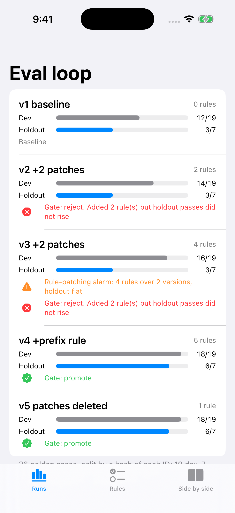

# EvalLoop — build the eval harness before you tune anything

A small Swift package that shows the part of an AI feature a lead actually owns: the loop that tells you whether a change helped. It ships a golden set with a hash-fixed dev/holdout split, a side-by-side regression report, a "does this rule generalise?" check, a redundancy audit for hand-written fix-up rules, a promotion gate, and an alarm for the moment a project slides from evaluation into rule-patching.

Article: (added after publish)



## What the demo shows

The model under test is a deterministic stand-in for an on-device categoriser of card-statement descriptors (`SQ *BLUE BOTTLE COFFEE` → `Coffee`). It has one weakness built in on purpose: it reads only the leading word, so payment-processor prefixes hide the merchant. It is **not** a real model; it exists so every number below can be re-derived with `swift test`.

26 golden cases, split by an FNV-1a hash of each case ID (33% target): **19 dev, 7 holdout**.

| Version | Rules | Dev | Holdout | Gate (vs previous) |
|---|---|---|---|---|
| v1 baseline | 0 | 12/19 | 3/7 | — |
| v2 +2 patches | 2 | 14/19 | 3/7 | reject: rules without holdout gain |
| v3 +2 patches | 4 | 16/19 | 3/7 | reject; **rule-patching alarm** (4 rules over 2 versions, holdout flat) |
| v4 +prefix rule | 5 | 18/19 | 6/7 | promote |
| v5 patches deleted | 1 | 18/19 | 6/7 | promote |

- Each of the four patch rules is `patchOnly`: it fixes the one dev case it was written for and nothing on the holdout.
- `strip-processor-prefix` is `generalises`: it fixes holdout cases `t06`, `t14`, `t23` that nobody wrote it for.
- Once it lands, `RuleAudit` reports all four patches as redundant. v5 deletes them with no change in any outcome.
- `patch-mkt-groceries`, written by peeking at holdout case `t17`, is flagged `leaksHoldout` (and it also breaks `t21`).
- Every run costs 26 calls × 0.5 units = 13 units against a gate budget of 15.

## The pieces

```swift
let harness = SampleScenario.harness()
let base = harness.run(SampleScenario.v1)
let candidate = harness.run(SampleScenario.v4)

let report = RegressionReport(base: base, candidate: candidate)
report.holdout.fixed            // ["t06", "t14", "t23"]

let check = RuleCheck(rule: SampleScenario.stripProcessorPrefix,
                      on: SampleScenario.v1, harness: harness)
check.verdict                   // .generalises

SampleScenario.gate.decide(base: base, candidate: candidate,
                           candidateRules: SampleScenario.v4.rules,
                           golden: harness.golden)   // .promote
```

| Type | Job |
|---|---|
| `GoldenSet` | Validates IDs, assigns dev/holdout by hash so adding cases never moves old ones |
| `Rule` | A fix-up (`rewriteInput` or `overrideOutput`) that records the cases it was `writtenFor` |
| `Harness` / `EvalRun` | Deterministic run of a `PipelineVersion`, per-case results, fired rules, cost |
| `RegressionReport` | Fixed / broken per split — the side-by-side page |
| `RuleCheck` | `leaksHoldout` › `harmful` › `generalises` › `patchOnly` › `noEffect` |
| `RuleAudit` | Rules whose removal changes no outcome |
| `PromotionGate` | Holdout must not drop or regress, no leaks, budget held, new rules must raise holdout |
| `PatchingAlarm` | Consecutive versions that add rules while holdout stays flat |

## How to run it

```bash
git clone https://github.com/rajatslakhina/eval-harness-first-article-demo.git
cd eval-harness-first-article-demo
swift test                 # 17 tests
open Demo.xcodeproj        # pick an iPhone Simulator, then Build & Run
```

No other setup: `Demo.xcodeproj` consumes the package through a local package reference (`relativePath = .`), and the `Demo` scheme is shared.

## Verification status

- `swift build -Xswiftc -warnings-as-errors` and `swift test` (17 tests, 0 failures) pass on Swift 6.1.2, Linux x86_64.
- The Simulator run happens in CI: `.github/workflows/ci.yml` builds `Demo.xcodeproj` on a macOS runner, installs and launches the app on an iPhone Simulator, checks it is still running after 8 seconds, and commits the screenshots in `Demo/Screenshots/`. See the Actions tab for the run.

## Source

Prompted by Natasha Murashev's [What I Learned from Tuning an Open Source Model for my App](https://www.natashatherobot.com/p/tuning-an-open-source-model) (6 Oct 2026). The code and the argument here are my own.

MIT licensed.
